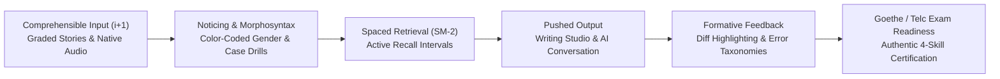
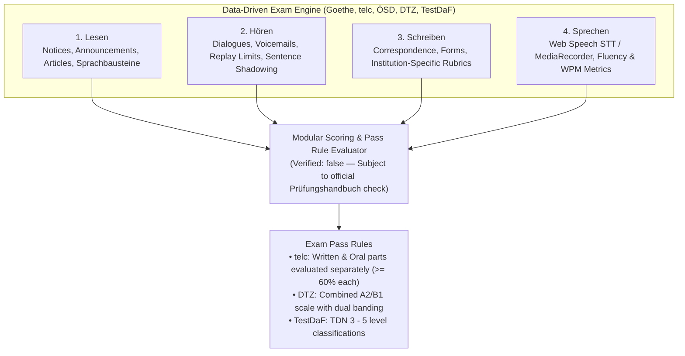
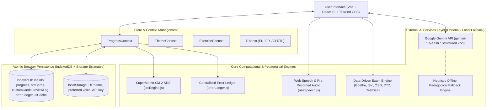
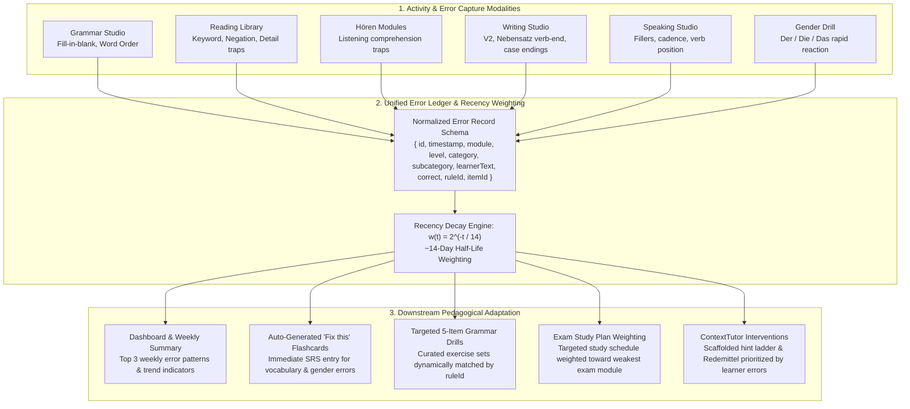

# 🇩🇪 DeutschPath (A1 – B2)
### *The Complete Pedagogical & Architectural Specification for Self-Directed German Mastery*

[](https://react.dev/)
[](https://vite.dev/)
[](https://tailwindcss.com/)
[](https://www.coe.int/en/web/common-european-framework-reference-languages)
[](https://opensource.org/licenses/MIT)

---

## 📑 Table of Contents

1. [Executive Overview & Product Vision](#1-executive-overview--product-vision)
2. [Applied Linguistics & Second Language Acquisition (SLA) Pedagogy](#2-applied-linguistics--second-language-acquisition-sla-pedagogy)
   - [2.1 CEFR Framework Mapping (A1 through B2)](#21-cefr-framework-mapping-a1-through-b2)
   - [2.2 Cognitive Foundations & SLA Theoretical Pillars](#22-cognitive-foundations--sla-theoretical-pillars)
   - [2.3 Chromatic Encoding: Decoupling Grammatical Gender](#23-chromatic-encoding-decoupling-grammatical-gender)
   - [2.4 German Morphosyntax & Structural Topology](#24-german-morphosyntax--structural-topology)
   - [2.5 Spaced Repetition (SRS) & The Testing Effect](#25-spaced-repetition-srs--the-testing-effect)
   - [2.6 The 4 Communicative Competencies & Exam Simulations](#26-the-4-communicative-competencies--exam-simulations)
3. [System Architecture & Software Engineering Deep-Dive](#3-system-architecture--software-engineering-deep-dive)
   - [3.1 High-Level Architecture](#31-high-level-architecture)
   - [3.2 File & Directory Structure](#32-file--directory-structure)
   - [3.3 State Management & Data Persistence Layer](#33-state-management--data-persistence-layer)
   - [3.4 The Spaced Repetition (SuperMemo SM-2) Engine](#34-the-spaced-repetition-supermemo-sm-2-engine)
   - [3.5 Conversational AI Tutor Architecture](#35-conversational-ai-tutor-architecture)
   - [3.6 AI Writing Evaluation & Diff Highlighting Engine](#36-ai-writing-evaluation--diff-highlighting-engine)
   - [3.7 Speech Synthesis & Pre-Recorded Audio Architecture](#37-speech-synthesis--pre-recorded-audio-architecture)
   - [3.8 Progressive Web App (PWA) & Offline-First Precaching](#38-progressive-web-app-pwa--offline-first-precaching)
   - [3.9 Data Models & JSON Schemas](#39-data-models--json-schemas)
4. [Getting Started & Local Development](#4-getting-started--local-development)
   - [4.1 Prerequisites](#41-prerequisites)
   - [4.2 Installation & Startup](#42-installation--startup)
   - [4.3 Configuration & Environment Variables](#43-configuration--environment-variables)
   - [4.4 Build, Lint & Preview](#44-build-lint--preview)
5. [UX/UI & Accessibility Principles](#5-uxui--accessibility-principles)
6. [Security, Privacy & Data Portability](#6-security-privacy--data-portability)
7. [Roadmap & Contribution Guidelines](#7-roadmap--contribution-guidelines)
8. [License & Acknowledgments](#8-license--acknowledgments)

---

## 1. Executive Overview & Product Vision

**DeutschPath** is an autonomous, client-side German language acquisition platform engineered to shepherd adult independent learners from **CEFR A1 (Breakthrough)** to **CEFR B2 (Vantage)**. 

Traditional language apps often suffer from either:
- **Gamified over-simplification**: Superficial vocabulary drills decoupled from genuine communicative grammar and discourse competence.
- **Academic opacity**: Dense textbook grammars that neglect phonetic retention, active recall, and conversational pragmatics.

DeutschPath synthesizes **modern web engineering** (React 19, zero-latency client state, offline-first storage) with **empirically validated Second Language Acquisition (SLA) methodology** (Krashen’s Input Hypothesis, Swain’s Output Hypothesis, Schmidt’s Noticing Hypothesis, and the SuperMemo SM-2 algorithm).

### Core Architectural Pillars
- **Zero-Backend Dependency**: Runs 100% in the client browser. State, progress, review logs, and custom cards persist atomically in IndexedDB via `idb` with automatic schema migrations and Zod-validated backups.
- **Hybrid AI & Heuristic Fallbacks**: Communicative writing analysis and live AI dialogue powered by Google Gemini API, with built-in heuristic fallbacks ensuring complete offline functionality.
- **Complete Goethe / Telc Exam Mirroring**: Faithful simulation of the 4 official modules (*Lesen*, *Hören*, *Schreiben*, *Sprechen*) with strict CEFR time limits and scoring metrics.

---

## 2. Applied Linguistics & Second Language Acquisition (SLA) Pedagogy

Language acquisition is not rote memorization; it is the construction of an internal cognitive grammar (*interlanguage*) through comprehensible input, communicative feedback, and output modification.



### 2.1 CEFR Framework Mapping (A1 through B2)

DeutschPath maps its 32 units (8 units per level) to the Council of Europe's Common European Framework of Reference for Languages (CEFR):

| CEFR Level | Stage | Active Vocab Target | Syntactic & Grammatical Milestones | Pragmatic Can-Do Benchmarks |
|:---|:---|:---|:---|:---|
| **A1** | Breakthrough | ~600 – 800 words | Nominativ/Akkusativ, regular/irregular present tense, modal verbs (*können*, *müssen*, *möchten*), basic W-questions, V2 word order. | Introduce oneself, order food/drinks, ask directions, complete simple forms, understand slow, clear announcements. |
| **A2** | Waystage | ~1,200 – 1,500 words | Dativ case, two-way prepositions (*Wechselpräpositionen*), Perfekt past tense (*haben/sein* + Partizip II), reflexive verbs, basic comparative/superlative. | Describe past events/holidays, schedule appointments, handle routine shopping, express personal preferences and simple opinions. |
| **B1** | Threshold | ~2,500 – 3,000 words | Subordinating conjunctions (*weil*, *dass*, *obwohl*, *wenn*), Präteritum modal verbs, relative clauses (*Relativsätze*), passive voice (*Vorgangspassiv*), Konjunktiv II for polite requests/wishes. | Express and defend opinions, narrate complex experiences, write coherent personal/formal emails, participate in unprepared discussions. |
| **B2** | Vantage | ~4,500 – 5,500 words | Partizipialattribute, nominalization (*Nomen-Verb-Verbindungen*), passive substitutes (*sein zu*, *lassen sich*), complex connective adverbs (*infolgedessen*, *trotzdem*), Konjunktiv I (indirect speech). | Comprehend complex abstract and technical texts, argue nuanced viewpoints with pros/cons, produce clear, well-structured compositions, converse with native speakers with high spontaneous fluency. |

---

### 2.2 Cognitive Foundations & SLA Theoretical Pillars

1. **Krashen's Input Hypothesis ($i+1$) & Affective Filter**:
   Learners acquire language when exposed to input that is slightly above their current competence level ($i+1$), provided anxiety is minimized. DeutschPath delivers graded reading with instant inline hover translation, preventing cognitive overload and lowering the affective filter.

2. **Swain's Output Hypothesis**:
   Input alone is insufficient to internalize complex morphology. Learners must be "pushed" into output production (speaking and writing). Producing output forces learners to move from semantic processing to syntactic processing. DeutschPath’s **Writing Studio** and **AI Conversation Partner** create structured communicative pressure.

3. **Schmidt's Noticing Hypothesis**:
   Learners cannot incorporate grammatical forms into their interlanguage until they consciously notice them. DeutschPath utilizes typographic highlights, gender chromatic cues, and visual diffs to draw conscious attention to grammatical divergences.

4. **Dual-Coding Theory (Paivio)**:
   Encoding linguistic data through both verbal (textual/audio) and non-verbal (color/spatial) channels drastically enhances working memory consolidation and long-term retrieval strength.

---

### 2.3 Chromatic Encoding: Decoupling Grammatical Gender

One of the greatest hurdles for learners of German is grammatical gender (*Genus*). Unlike Romance languages where phonetic word endings often indicate gender, German noun gender is notoriously arbitrary to non-native speakers:
- *das Mädchen* (the girl: grammatically neuter)
- *die Sonne* (the sun: feminine)
- *der Mond* (the moon: masculine)

To eliminate the cognitive penalty of memorizing gender in isolation, DeutschPath implements a **universal chromatic encoding system**:

<div align="center">

| Grammatical Gender | Definite Article | Chromatic Palette | Hex Code | Pedagogical Anchor |
|:---:|:---:|:---:|:---:|:---|
| **Maskulin** | **der** | <span style="color:#2563eb; font-weight:bold;">Cobalt Blue</span> | `#2563EB` | Blue represents masculine across all flashcards, dictionary lookups, and reading readers. |
| **Feminin** | **die** | <span style="color:#dc2626; font-weight:bold;">Crimson Red</span> | `#DC2626` | Red represents feminine consistently. |
| **Neutrum** | **das** | <span style="color:#16a34a; font-weight:bold;">Emerald Green</span> | `#16A34A` | Green represents neuter consistently. |
| **Plural** | **die (Pl.)** | <span style="color:#9333ea; font-weight:bold;">Royal Purple</span> | `#9333EA` | Purple emphasizes the plural shift across all declensions. |

</div>

By consistently pairing nouns with their chromatic anchor, the brain develops an immediate visual memory trace before semantic parsing occurs.

---

### 2.4 German Morphosyntax & Structural Topology

German sentence structure differs fundamentally from English (SVO). DeutschPath's grammar engine is built around three critical topological rules:

#### A. The V2 (Verb-Zweit) Rule & Satzklammer (Sentence Frame)
In German main clauses (*Hauptsätze*), the conjugated verb is strictly anchored to **Position 2**, regardless of what occupies Position 1:

$$\text{Position 1 (Topic/Adverbial)} \quad + \quad \mathbf{\text{Verb}_{\text{conjugated}}} \quad + \quad \text{Subject} \quad + \quad \dots \quad + \quad \mathbf{\text{Verb}_{\text{infinite/prefix}}}$$

*Example*:
- *Heute* (Pos 1) **gehe** (Pos 2) *ich in die Schule*.
- *Ich* (Pos 1) **habe** (Pos 2) *gestern ein deutsches Buch* **gelesen** (Satzklammer Ende).

#### B. Subordinate Clause Topology (Nebensatz Verb-End)
In subordinate clauses introduced by subordinating conjunctions (*weil*, *dass*, *obwohl*, *wenn*), the finite verb is kicked to the absolute end of the clause:
- *Er lernt Deutsch, **weil** er in Berlin studieren **möchte**.*

#### C. Adverbial Sequencing: The TeKaMoLo Rule
When multiple adverbial phrases modify a verb, their canonical order follows:
1. **Te**mporal (*Wann?* — When?)
2. **Ka**usal (*Warum?* — Why?)
3. **Mo**dal (*Wie?* — How?)
4. **Lo**kal (*Wo/Wohin?* — Where/Where to?)

$$\text{Satz} \to \mathbf{\text{Temporal}} \to \mathbf{\text{Kausal}} \to \mathbf{\text{Modal}} \to \mathbf{\text{Lokal}}$$

*Example*: *Ich fahre* **morgen** (Te) **wegen der Arbeit** (Ka) **mit dem Zug** (Mo) **nach München** (Lo).

#### D. The Four-Case System (Kasus) Matrix
DeutschPath incorporates an active case-resolver engine across its quiz engine:

| Kasus | Function in Clause | Maskulin | Feminin | Neutrum | Plural |
|:---|:---|:---:|:---:|:---:|:---:|
| **Nominativ** | Subject (Wer oder was?) | *der / ein* | *die / eine* | *das / ein* | *die / -* |
| **Akkusativ** | Direct Object (Wen oder was?) | *den / einen* | *die / eine* | *das / ein* | *die / -* |
| **Dativ** | Indirect Object (Wem?) | *dem / einem* | *der / einer* | *dem / einem* | *den / -n* |
| **Genitiv** | Possession (Wessen?) | *des / eines (+s)* | *der / einer* | *des / eines (+s)* | *der / -* |

---

### 2.5 Spaced Repetition (SRS) & The Testing Effect

Cramming creates transient memory traces that decay according to the **Ebbinghaus Forgetting Curve**. To achieve durable memory consolidation in secondary cortical networks, reviews must occur at the threshold of forgetting.

DeutschPath implements the battle-tested **SuperMemo SM-2 algorithm** with in-session learning steps and pedagogical enhancements:

```
R (Retention)
 ^
1.0 |----\
    |     \--- (1m Step -> 10m Step -> Graduation: Day 1)
    |         \-----\
    |                \---- (Day 6 Review)
0.5 |                     \---------\
    |                                \----- (Day 15 Review)
    |                                      \------------ (Day 36 Review)
0.0 +------------------------------------------------------------------------> Time (Days)
```

- **In-Session Learning Steps**: New cards and lapsed cards reappear in-session after 1 minute and 10 minutes before graduating to day intervals.
- **Daily Queue Limits & Theme Interleaving**: Daily queues prioritize due reviews, followed by new cards (default 15/day, configurable), with cards interleaved by theme to prevent blocked practice.
- **Card Study Modes**: Supports 4 distinct recall modes per card:
  1. *Flip*: Classical bilateral card flip with audio.
  2. *Typing*: Active orthographic recall checking German article and spelling (accepts standard umlaut alternatives: *ae/oe/ue/ss*).
  3. *Cloze*: Sentence context recall with the target headword gap-deleted.
  4. *Listen & Type*: Native speech synthesis dictation transcription.
- **Swipe Gestures**: Touch and pointer drag gestures (Swipe Right = Good, Swipe Left = Again) alongside keyboard hotkeys (1-4 and Space).
- **Leech Detection & Mnemonic Anchors**: Cards failing 8+ times are flagged as leeches, prompting the learner to attach a personal mnemonic hook to resolve cognitive interference.

---

### 2.6 The 4 Communicative Competencies & Data-Driven Exam Simulations

DeutschPath prepares learners for official certifications (**Goethe-Zertifikat**, **telc Deutsch**, **ÖSD**, **DTZ**, and **TestDaF**) by testing the 4 primary communicative competencies under authentic exam formats.

Rather than hardcoding arbitrary grading rules, all exam formats, modules, durations, task types, point systems, and pass thresholds are driven by modular definitions in `src/data/exams/{goethe,telc,osd,dtz,testdaf}.js`:



> [!WARNING]
> **Scoring Rule Verification Status**: All exam scoring formulas, module point allocations, and pass criteria are sourced directly from published examination guidelines (with canonical reference links in each data file) but are explicitly tagged with `verified:false` pending manual verification against the latest published testing regulations. All AI-generated feedback is labeled as an **estimate** (`estimateOnly: true`).

---

## 3. System Architecture & Software Engineering Deep-Dive

### 3.1 High-Level Architecture

DeutschPath is built as an offline-first single-page application (SPA) optimized for zero network roundtrips for all core learning loops:



### 3.1.1 Architecture of the Error Ledger Loop

Every learner mistake across all modalities feeds a unified, recency-weighted error tracking engine that continuously adapts practice queues, diagnostic cards, and tutor interventions:



---

### 3.2 File & Directory Structure

```
deutschpath/
├── index.html                   # HTML entry point with viewport & font configurations
├── package.json                 # Project dependencies & operational scripts
├── vite.config.js               # Vite bundler configuration & React plugin
├── tailwind.config.js           # Tailwind typography & dark mode extensions
├── .oxlintrc.json               # High-performance Oxlint rules
├── src/
│   ├── main.jsx                 # React root initialization & context providers
│   ├── App.jsx                  # Primary navigation router & view dispatcher
│   ├── App.css                  # Global styles & keyframe animations
│   ├── index.css                # Tailwind directives & CSS variable tokens
│   │
│   ├── assets/                  # Static SVGs, images, and brand assets
│   │
│   ├── components/              # Modular UI Component Library
│   │   ├── common/              # Atomic reusable UI components
│   │   │   ├── AudioButton.jsx  # Web Speech pronunciation trigger
│   │   │   ├── Badge.jsx        # CEFR level & category badge pills
│   │   │   ├── Button.jsx       # Standard accessible button variants
│   │   │   ├── Card.jsx         # Card containers with elevation styles
│   │   │   ├── Modal.jsx        # Dialog modals with focus trap
│   │   │   ├── ProgressBar.jsx  # Smooth animated progress indicators
│   │   │   └── ThemeToggle.jsx  # Light/Dark mode switcher
│   │   │
│   │   ├── conversation/        # AI Dialogue Partner Components
│   │   │   ├── ApiKeyModal.jsx  # Gemini API key configuration
│   │   │   ├── ChatMessage.jsx  # Chat speech bubbles with TTS triggers
│   │   │   ├── CorrectionBox.jsx# Real-time grammatical correction card
│   │   │   └── ScenarioSelector.jsx # Real-world simulation scenario cards
│   │   │
│   │   ├── dashboard/           # Analytics & Progress Components
│   │   │   ├── GrammarAccuracyList.jsx # Accuracy gauges per grammatical category
│   │   │   ├── LevelReadinessCard.jsx  # CEFR readiness composite score
│   │   │   └── StudyTimeChart.jsx      # Interactive SVG 7-day/14-day study chart
│   │   │
│   │   ├── exam/                # Goethe-Zertifikat Exam Simulation
│   │   │   ├── ExamModuleLesen.jsx     # Reading comprehension module
│   │   │   ├── ExamModuleHoeren.jsx    # Audio listening module with replay limits
│   │   │   ├── ExamModuleSchreiben.jsx # Composition module with word counter
│   │   │   └── ExamModuleSprechen.jsx  # Spoken prompt & model answer module
│   │   │
│   │   ├── flashcards/          # Spaced Repetition Flashcard System
│   │   │   ├── FlashcardItem.jsx       # 3D flippable card with chromatic gender
│   │   │   ├── CustomCardModal.jsx     # Vocabulary creation dialog
│   │   │   ├── DeckSelector.jsx        # Filter by CEFR level & custom cards
│   │   │   ├── GenderColorToggle.jsx   # Toggle chromatic gender assistance
│   │   │   └── ReviewSummaryModal.jsx  # Post-review XP & retention metrics
│   │   │
│   │   ├── grammar/             # Grammar Studio & Weak Spot Components
│   │   │   ├── GrammarRuleCard.jsx     # Rule breakdown & morphological tables
│   │   │   └── WeakSpotsView.jsx       # Targeted drill recommender
│   │   │
│   │   ├── layout/              # Structural Scaffold Components
│   │   │   ├── Navbar.jsx              # Header with streak & XP tracker
│   │   │   ├── Sidebar.jsx             # Desktop collapsible navigation rail
│   │   │   └── BottomNav.jsx           # Mobile touch-friendly bottom bar
│   │   │
│   │   ├── quiz/                # Interactive Assessment Engines
│   │   │   ├── QuizEngine.jsx          # Multi-format quiz processor
│   │   │   └── GenderDrill.jsx         # High-speed Der/Die/Das reaction arcade
│   │   │
│   │   ├── reading/             # Graded Reading Library (Leseecke)
│   │   │   ├── InteractiveReader.jsx   # Graded text viewer with tap-to-inspect
│   │   │   ├── ReadingQuiz.jsx         # Post-reading comprehension checks
│   │   │   └── WordInspectorModal.jsx  # Deep morphology popup & 1-click deck add
│   │   │
│   │   ├── roadmap/             # Curriculum Roadmap Visualization
│   │   │   ├── LessonNode.jsx          # Circular unit milestone node
│   │   │   ├── LevelSelector.jsx       # A1-B2 level tabs
│   │   │   └── UnitCard.jsx            # Detailed lesson unit overview
│   │   │
│   │   └── writing/             # AI Writing Studio
│   │       ├── DiffHighlighter.jsx     # Character/word-level diff viewer
│   │       ├── MistakesList.jsx        # Grouped taxonomy of writing errors
│   │       └── ModelAnswerCard.jsx     # Level +1 enhanced model answer
│   │
│   ├── context/                 # React Context State Providers
│   │   ├── ProgressContext.jsx  # Universal learner progress, SRS & stats state
│   │   └── ThemeContext.jsx     # Dark/Light theme provider
│   │
│   ├── data/                    # Static Pedagogical Datasets & Seeds
│   │   ├── curriculum.json      # Complete 32-unit curriculum structure
│   │   ├── curriculum.js        # Helper queries for lessons & units
│   │   ├── flashcardsA1.json    # 50 seed flashcards with morphology & audio cues
│   │   ├── derDieDasSeed.js     # High-speed gender drill vocabulary seed
│   │   ├── grammarExercisesA1.json # Structured grammar challenges & rationales
│   │   ├── readingTexts.json    # 12 graded CEFR reading passages
│   │   ├── examMockData.json    # Official-format Goethe-Zertifikat mock exams
│   │   └── levels/              # Modular per-level curriculum extensions
│   │       ├── a1.js
│   │       ├── a2.js
│   │       ├── b1.js
│   │       └── b2.js
│   │
│   ├── hooks/                   # Custom React Hooks
│   │   ├── useLocalStorage.js   # Type-safe atomic localStorage sync
│   │   └── useSpeech.js         # Browser SpeechSynthesis API wrapper
│   │
│   ├── pages/                   # Primary Application Views
│   │   ├── RoadmapPage.jsx      # A1-B2 progression map
│   │   ├── LessonPage.jsx       # Individual lesson unit with exercises
│   │   ├── PracticePage.jsx     # Spaced Repetition flashcard session
│   │   ├── GrammarPage.jsx      # Interactive Grammar Studio & Weak Spots
│   │   ├── ConversationPage.jsx # AI German conversation tutor
│   │   ├── WritingPage.jsx      # AI German writing composition studio
│   │   ├── ReadingPage.jsx      # Graded reading library with tap-to-translate
│   │   ├── ExamPrepPage.jsx     # Goethe exam simulation & certification
│   │   ├── DashboardPage.jsx    # Analytics, study streaks & CEFR readiness
│   │   ├── DictionaryPage.jsx   # Searchable lexicon & morphology index
│   │   └── SettingsPage.jsx     # API keys, data backup/restore & reset
│   │
│   ├── services/                # External API Integrations
│   │   ├── aiTutorService.js    # Gemini chat service with pedagogical system prompts
│   │   └── aiWritingService.js  # Text correction, diff analysis & rubric grading
│   │
│   └── utils/                   # Pure Helper Functions & Algorithms
│       ├── srsEngine.js         # SuperMemo SM-2 mathematical implementation
│       ├── soundEffects.js      # Synthesized Web Audio API celebratory chimes
│       └── textFormatting.js    # String utilities, sanitizers & regex parsers
```

---

### 3.3 State Management & Data Persistence Layer

All user progression is managed through `ProgressContext.jsx` and synchronized via the `useLocalStorage.js` hook. The state tree maintains the following structure:

```typescript
interface LearnerProgressState {
  xp: number;                                    // Total experience points accumulated
  streak: number;                                // Current consecutive days streak
  lastActiveDate: string;                        // ISO date string (YYYY-MM-DD)
  completedLessons: string[];                    // IDs of completed lessons
  unitProgress: Record<string, number>;          // Unit ID -> percentage (0 - 100)
  srsCards: Record<string, SM2CardRecord>;       // Card ID -> SM-2 review metadata
  starredCards: string[];                        // Array of favored card IDs
  genderDrillHighScore: number;                  // Top score in speed drill
  grammarStats: Record<string, GrammarTopicStat>;// Topic -> accuracy analytics
  readingScores: Record<string, ReadingScore>;   // Text ID -> quiz scores
  dailyStudyMinutes: Record<string, number>;     // Date -> minutes spent
  examHistory: ExamResult[];                     // Full Goethe exam attempts history
  dailyGoalMinutes: number;                      // Daily target (default: 30)
}
```

#### Atomic Sync & Error Safety
The `useLocalStorage` hook incorporates `try/catch` fallbacks to prevent runtime crashes if `localStorage` quota is exceeded or cookies are blocked. A built-in broadcast listener allows multiple tabs to remain synchronously updated.

---

### 3.4 The Spaced Repetition (SuperMemo SM-2) Engine

The mathematical heart of DeutschPath's vocabulary retention system is encapsulated in `src/utils/srsEngine.js`.

#### Mathematical Formulation

For each review event, the user rates their recall quality $q \in \{1, 3, 4, 5\}$:
- $q = 1$: **Again** (Total blackout / incorrect recall)
- $q = 3$: **Hard** (Correct with substantial hesitation)
- $q = 4$: **Good** (Correct response with modest effort)
- $q = 5$: **Easy** (Immediate, effortless retrieval)

##### 1. Ease Factor ($EF$) Calculation
The Ease Factor reflects the intrinsic difficulty of a given card. It begins at $2.5$ and is updated after each review:

$$EF' = \max\left(1.3, \; EF + \left(0.1 - (5 - q) \times \left(0.08 + (5 - q) \times 0.02\right)\right)\right)$$

*Note*: The lower bound of $1.3$ ensures that cards do not enter an unrecoverable "ease hell" death spiral.

##### 2. Interval ($I$) Calculation
The interval $I$ (in days until next review) is calculated as:

$$I(n) = \begin{cases} 
1 & \text{if } q < 3 \quad (\text{Reset on failure}) \\
1 & \text{if } n = 1 \\
6 & \text{if } n = 2 \\
\text{round}(I(n-1) \times EF) & \text{if } n > 2 \text{ and } q \ge 3 
\end{cases}$$

For $q = 3$ (*Hard*), interval growth is dampened by a $1.2\times$ factor:

$$I_{\text{hard}} = \max\left(I(n-1) + 1, \; \text{round}(I(n-1) \times 1.2)\right)$$

For $q = 5$ (*Easy*), an additional $1.15\times$ bonus multiplier is applied.

##### Code Implementation (`src/utils/srsEngine.js`)

```javascript
export function calculateSM2Review(cardId, currentRecord, rating) {
  const record = currentRecord
    ? { ...currentRecord, cardId }
    : createInitialCardRecord(cardId);

  const q = SM2_QUALITIES[rating];
  const now = new Date();

  let repetitions = record.repetitions || 0;
  let interval = record.interval || 0;
  let easeFactor = typeof record.easeFactor === "number" ? record.easeFactor : 2.5;
  let lapses = record.lapses || 0;

  // 1. Calculate new Ease Factor
  const deltaEF = 0.1 - (5 - q) * (0.08 + (5 - q) * 0.02);
  easeFactor = Math.max(1.3, Number((easeFactor + deltaEF).toFixed(3)));

  // 2. Calculate interval and repetitions based on quality
  if (q < 3) {
    repetitions = 0;
    interval = 1;
    lapses += 1;
  } else {
    if (repetitions === 0) {
      interval = 1;
    } else if (repetitions === 1) {
      interval = q === 3 ? 3 : 6;
    } else {
      if (q === 3) {
        interval = Math.max(interval + 1, Math.round(interval * 1.2));
      } else if (q === 4) {
        interval = Math.max(interval + 1, Math.round(interval * easeFactor));
      } else if (q === 5) {
        interval = Math.max(interval + 2, Math.round(interval * easeFactor * 1.3));
      }
    }
    repetitions += 1;
  }

  const isLeech = lapses >= LEECH_THRESHOLD;
  const nextReviewDate = getNextReviewDate(interval, now);

  return {
    ...record,
    repetitions,
    interval,
    easeFactor,
    lapses,
    isLeech,
    lastReviewed: now.toISOString(),
    nextReviewDate
  };
}
```

##### In-Session Learning Steps & Queue Scheduling (`processLearningStepReview`)
```javascript
// Step 0: 1m, Step 1: 10m -> Graduation to Day intervals
export const LEARNING_STEPS_MINUTES = [1, 10];
```
- In-session reviews of new or lapsed cards re-queue cards at 1-minute and 10-minute intervals before graduation.
- Daily study queues (`buildStudyQueue`) prioritize due reviews first, followed by new cards (default 15/day), interleaved by theme to prevent blocked cognitive fatigue.

  return {
    ...record,
    repetitions,
    interval,
    easeFactor,
    lastReviewed: now.toISOString(),
    nextReviewDate: nextDate.toISOString()
  };
}
```

---

### 3.5 Conversational AI Tutor Architecture

The AI German Tutor (`src/services/aiTutorService.js`) transforms the user's browser into a 1-on-1 language lab.

#### System Prompt Engineering
The system prompt enforces strict pedagogical rules:
1. **Target-Language Immersion**: The tutor responds primarily in German calibrated to the learner's designated CEFR level (A1 uses simple present and high-frequency vocabulary; B2 uses complex subordinate clauses and modal particles).
2. **Scaffolded Correction**: Rather than interrupting the conversation flow, corrections are delivered in a structured schema.
3. **Structured JSON Output**: When calling Gemini API, the response is parsed into:
   ```json
   {
     "reply": "German conversation response...",
     "correction": {
       "hasError": true,
       "original": "Learner text",
       "corrected": "Corrected German text",
       "explanation": "Clear explanation of grammar rule in English"
     }
   }
   ```
4. **Offline Heuristic Engine**: If an API key is not configured, the service matches learner input against regex patterns to return authentic, pre-recorded situational dialogues.

---

### 3.6 AI Writing Evaluation, Multi-Institution Rubrics & Diff Highlighting

The Writing Studio (`src/services/aiWritingService.js`) enables deliberate practice of written German according to official examination standards.

#### Data-Driven Multi-Institution Rubrics
Scoring rubrics are defined in `src/data/rubrics/{goethe,telc,osd,dtz,testdaf}.json` with level, criteria, weights, max points (e.g., 25 pts for Goethe/telc, 15 pts for ÖSD, DTZ scales), and official source documentation links:

```json
{
  "institution": "goethe",
  "level": "A1",
  "maxScore": 25,
  "verified": false,
  "source": "https://www.goethe.de/pro/relaunch/prf/de/Goethe-Zertifikat_A1_SD1_Uebungssatz_01.pdf",
  "criteria": [
    { "name": "Task Fulfillment", "max": 10, "description": "All required content points addressed" },
    { "name": "Coherence", "max": 5, "description": "Logical flow and basic sentence connectors" },
    { "name": "Vocabulary & Grammar", "max": 10, "description": "Accurate A1 lexical range, V2 verb order, and case endings" }
  ]
}
```

> [!IMPORTANT]
> **Scoring Disclaimer**: All rubrics are flagged as `verified:false` pending manual verification against the latest official exam guidelines. AI-evaluated writing submissions are explicitly marked as **estimates** (`estimateOnly: true`), and an offline pedagogical fallback validates draft length, connector counts, V2 word order, and formal/informal consistency.

#### Structured Evaluation Pipeline & UI Order
Writing evaluation output conforms to a strict pedagogical sequence:
1. **Required Content Checklist**: Validates that each prompt task point is covered, accompanied by direct learner evidence.
2. **Criteria Breakdown with Evidence**: Specific subscores, rationale, and targeted actionable suggestions.
3. **Word-Level Diff Highlighting (`DiffHighlighter.jsx`)**: Token-by-token diff highlighting:
   - <span style="background-color:#fee2e2; color:#b91c1c; text-decoration:line-through; padding:2px 4px; border-radius:3px;">Red strikethrough</span> for superfluous or erroneous tokens.
   - <span style="background-color:#dcfce7; color:#15803d; font-weight:bold; padding:2px 4px; border-radius:3px;">Green highlight</span> for inserted corrections.
4. **Grouped Error Taxonomy (`MistakesList.jsx`)**: Mistakes mapped directly to the shared pedagogical error taxonomy, with a 1-tap "Make flashcards from my mistakes" button.
5. **Interactive Paragraph Rewrite (`RewriteParagraphCard.jsx`)**: Pushes learners into immediate guided output repair.
6. **CEFR +1 Model Answer (`ModelAnswerCard.jsx`)**: Stylistic exemplar calibrated exactly one level higher than the prompt.

---

### 3.7 Speech Synthesis & Pre-Recorded Audio Architecture

DeutschPath features a dual-mode audio pipeline in `src/hooks/useSpeech.js` combining authentic pre-recorded audio assets with browser neural TTS:
- **Neural Voice Ranking**: Automatically detects and scores available German voices (`de-DE`, `de-*`), prioritizing neural and enhanced engines (Google Deutsch, Microsoft Stefan/Katja) over generic voices.
- **User Preference Persistence**: Remembers the learner's chosen voice in `localStorage` (`deutschpath_preferred_voice_de`).
- **Multi-Platform Setup Guide**: When no native German voice is installed (`hasGermanVoice === false`), provides platform-specific setup instructions for Windows 10/11, macOS, iOS, Android, and recommended browsers.
- **Dual-Mode Audio Player**: Prefers pre-recorded MP3 audio files (`/audio/{id}.mp3`) for core vocabulary and listening mock tasks, with automatic instant fallback to ranked TTS if an audio file is missing or offline.
- **Pitch & Rate Modulation**: Supports Slow Mode (0.75x) for beginners and Standard Mode (0.95x) with cancellation on component unmount.

---

### 3.8 Progressive Web App (PWA) & Offline-First Precaching

Built with `vite-plugin-pwa` and Workbox for 100% offline availability:
- **Web App Manifest (`manifest.webmanifest`)**: Configured with `display: standalone`, `start_url: /`, `theme_color: #f59e0b`, and crisp 192x192, 512x512, and maskable icons.
- **App Shell & Level Data Precaching**: Workbox precaches all app shell assets, HTML, CSS, JavaScript, dynamic translation JSON catalogs, and level data chunks.
- **Runtime Caching**:
  - `CacheFirst` for pre-recorded audio assets (`/audio/*.mp3`, 60-day expiration).
  - `StaleWhileRevalidate` for Google Fonts and dynamic level chunks.
- **Update Prompt (`<PwaUpdatePrompt />`)**: Seamless banner that alerts the user when a new app version is available with a single-tap "Update Now" reload action.
- **Lighthouse CI Targets**:
  - Performance: `> 90%`
  - Accessibility: `> 95%`
  - PWA: `Pass` (verified via `npm run audit:pwa` and `.lighthouserc.json`).

---

### 3.9 Data Models & JSON Schemas

All static pedagogical resources are organized as strictly typed JSON documents:

#### A. Curriculum Unit (`src/data/curriculum.json`)
```json
{
  "id": "a1-u1",
  "level": "A1",
  "unitNumber": 1,
  "title": "Erste Schritte & Hallo",
  "description": "Greetings, introducing oneself, and numbers 0–20",
  "lessons": [
    {
      "id": "a1-u1-l1",
      "title": "Guten Tag! (Greetings)",
      "type": "vocabulary",
      "words": [
        {
          "german": "der Name",
          "article": "der",
          "plural": "die Namen",
          "english": "name",
          "exampleDe": "Mein Name ist Lukas.",
          "exampleEn": "My name is Lukas."
        }
      ]
    }
  ]
}
```

#### B. Flashcard Object (`src/data/flashcardsA1.json`)
```json
{
  "id": "fc-a1-001",
  "german": "der Tisch",
  "article": "der",
  "gender": "masculine",
  "plural": "die Tische",
  "english": "table",
  "level": "A1",
  "category": "Home & Furniture",
  "exampleDe": "Der Tisch ist aus Holz.",
  "exampleEn": "The table is made of wood."
}
```

#### C. Grammar Exercise Object (`src/data/grammarExercisesA1.json`)
```json
{
  "id": "gm-a1-001",
  "topic": "accusative_articles",
  "topicLabel": "Akkusativ Articles",
  "type": "fill_in_blank",
  "question": "Ich habe ___ Hund.",
  "options": ["einen", "ein", "eine", "einem"],
  "correctAnswer": "einen",
  "explanation": "Hund is masculine (der Hund). In the accusative case (direct object), 'ein' becomes 'einen'."
}
```

---

## 4. Getting Started & Local Development

### 4.1 Prerequisites
- **Node.js**: `v18.0.0` or higher (Node 20+ recommended)
- **npm**: `v9.0.0` or higher

### 4.2 Installation & Startup

1. **Clone or navigate to the repository**:
   ```bash
   cd deutschpath
   ```

2. **Install all dependencies**:
   ```bash
   npm install
   ```

3. **Launch the development server**:
   ```bash
   npm run dev
   ```

4. **Access the application**:
   Open [http://localhost:5173](http://localhost:5173) in any modern browser (Chrome, Edge, Firefox, Safari).

---

### 4.3 Configuration & Environment Variables

DeutschPath is an **offline-first single-page application** that operates 100% without external servers.

#### Recommended Setup: In-App User Key Storage
Because DeutschPath runs purely in the client browser, **never embed production API keys into `.env` build bundles** (any `VITE_` variable is compiled directly into static JavaScript and visible to anyone inspecting the network tab).

- **Recommended Approach**: Enter your personal API key directly in the application under **Settings ➔ Google Gemini API Key**. The key is stored exclusively in your browser’s isolated `localStorage` and sent over HTTPS only when interacting with Gemini.
- **Offline Heuristic Mode (Zero Key Required)**: If you do not enter an API key, all AI features fall back to local rule-based heuristic engines (regex V2/verb-end syntactic analysis, task requirement counters, pre-recorded audio dialogues, and static CEFR+1 model answers).
- **Optional Local Dev `.env`**: For local development only, you may create a `.env` file (verified in `.gitignore`):
  ```env
  VITE_GEMINI_API_KEY=your_gemini_api_key_here
  ```

---

### 4.4 Build, Lint, Audit & Test Commands

- **Development Server**:
  ```bash
  npm run dev
  ```

- **Production Build (Code-Split & Tree-Shaken)**:
  ```bash
  npm run build
  ```

- **Bundle Size Budget Analysis (<= 250 KB gzip)**:
  ```bash
  npm run analyze:bundle
  ```

- **Oxlint & Pedagogical Content Validation**:
  ```bash
  npm run lint
  ```

- **i18n Translation Completeness Audit**:
  ```bash
  npm run check:translations
  ```

- **Lighthouse CI & PWA Compliance Check**:
  ```bash
  npm run audit:pwa
  ```

- **Unit & Integration Tests (Vitest)**:
  ```bash
  npm test
  ```

- **End-to-End Smoke Tests (Playwright)**:
  ```bash
  npm run test:e2e
  ```

---

## 5. UX/UI & Accessibility Principles

- **Mobile-First Responsive Layout**: Includes a touch-friendly bottom navigation bar on mobile viewports ($< 768\text{px}$) and a collapsible navigation sidebar on desktop ($\ge 768\text{px}$).
- **Adaptive WCAG AA Color Contrast**: Rather than applying static hex codes that fail contrast on either light or dark backgrounds, DeutschPath employs **theme-adaptive chromatic tokens**:
  - *Light Mode*: Deep Blue `#1D4ED8`, Crimson Red `#B91C1C`, Forest Green `#15803D`, and Royal Purple `#7E22CE` ensure $\ge 4.5:1$ contrast against pure white and light slate surfaces.
  - *Dark Mode*: High-luminance tinted tokens (Sky `#60A5FA`, Coral `#F87171`, Emerald `#4ADE80`, Violet `#C084FC`) provide $\ge 7:1$ contrast against dark slate `#0F172A`.
- **Pedagogical Contrast Mode in Grammar Studio**: Supports interactive side-by-side morphological contrastive analysis (e.g. Akkusativ vs. Dativ with two-way prepositions / *Wechselpräpositionen*: directional movement *Wohin?* vs. stationary location *Wo?*).
- **Keyboard Navigation & Hotkeys**:
  - `Space`: Flip flashcard.
  - `1`: Rate *Again* ($q=1$).
  - `2`: Rate *Hard* ($q=3$).
  - `3`: Rate *Good* ($q=4$).
  - `4`: Rate *Easy* ($q=5$).
- **Reduced Motion Support**: All celebratory animations (confetti particles) automatically detect and respect `prefers-reduced-motion: reduce`.
- **Sound Off by Default**: Auditory feedback is strictly opt-in via Settings (`sound_enabled: false` by default).

---

## 6. Security, Privacy & Data Portability

- **100% Client-Side Privacy**: Zero tracking scripts, zero telemetric pixels, zero cookies.
- **Client-Side Key Isolation**: Gemini API keys are kept strictly in browser `localStorage`, never exposed in public build artifacts, and sent directly to Google's official API endpoint over HTTPS.
- **Atomic IndexedDB Architecture**: Full learner progress, spaced repetition state, error ledger logs, and AI caches persist in browser IndexedDB with automated migrations and pre-migration rollback snapshots.
- **Full Data Ownership & Portability**:
  - **Export**: Export complete learning data as a Zod-validated `deutschpath_backup.json` at any time.
  - **Restore**: Easily import backups with automatic field repair and schema validation across browsers.
  - **30-Day Backup Alert**: Visual reminder in Settings if 30 days elapse without a local data export.

---

## 7. Roadmap & Verification Status

- [x] CEFR A1–B2 32-unit structured roadmap with adaptive placement testing and mastery gating.
- [x] SuperMemo SM-2 Spaced Repetition flashcards with theme interleaving, leech detection, and typing/cloze recall.
- [x] Graded Reading Library with tap-to-inspect morphology and 1-tap deck addition.
- [x] Data-driven simulated exams (**Goethe-Zertifikat**, **telc**, **ÖSD**, **DTZ**, **TestDaF**) with modular pass rules (*verified:false*).
- [x] AI Speaking Studio & ExamModuleSprechen with Web Speech API recognition, MediaRecorder audio fallback, local fluency metrics (WPM, fillers), and sentence shadowing.
- [x] AI Writing Studio with multi-institution rubrics (*verified:false*), word-level DiffHighlighter, and CEFR+1 model answers.
- [x] Unified Centralized Error Ledger with recency-weighted exponential decay (~14-day half-life).
- [x] Multilingual i18n support (English, French, Arabic RTL with logical CSS utilities).
- [x] Installable Offline Progressive Web App (PWA) with Workbox service worker and pre-cached audio.
- [x] First-visit "Try one exercise" onboarding flow with diagnostic assessment and 7-day personalized plan.
- [ ] **C1 Advanced Level Expansion**: Stubbed in curriculum architecture; expanding advanced business and university modules.
- [ ] **Anki Deck (.apkg) Import/Export**: Direct binary interoperability with desktop Anki collections.

---

## 8. License & Acknowledgments

This project is open-source under the [MIT License](LICENSE).

Developed with ❤️ for German language learners worldwide. *Viel Erfolg beim Deutschlernen!*
